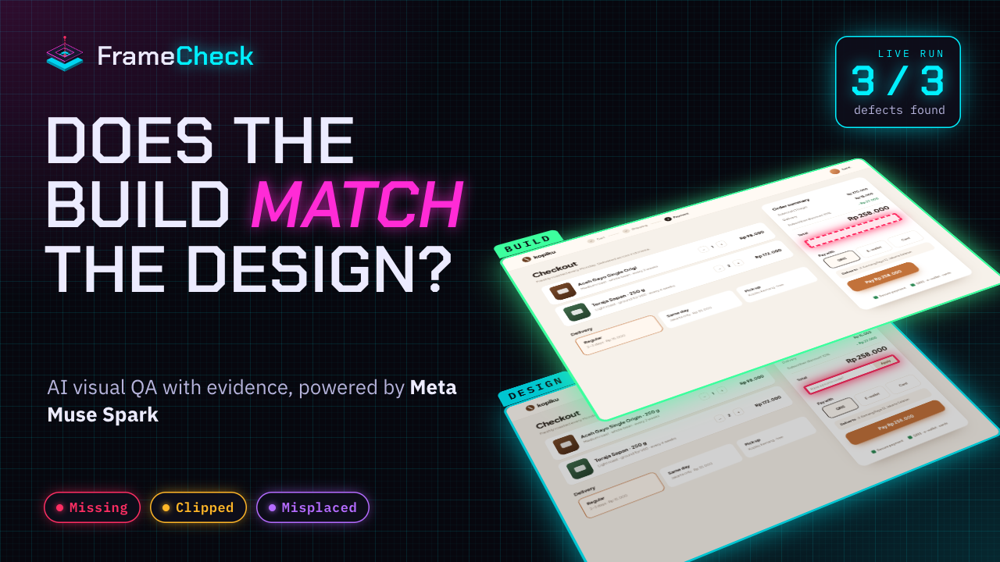
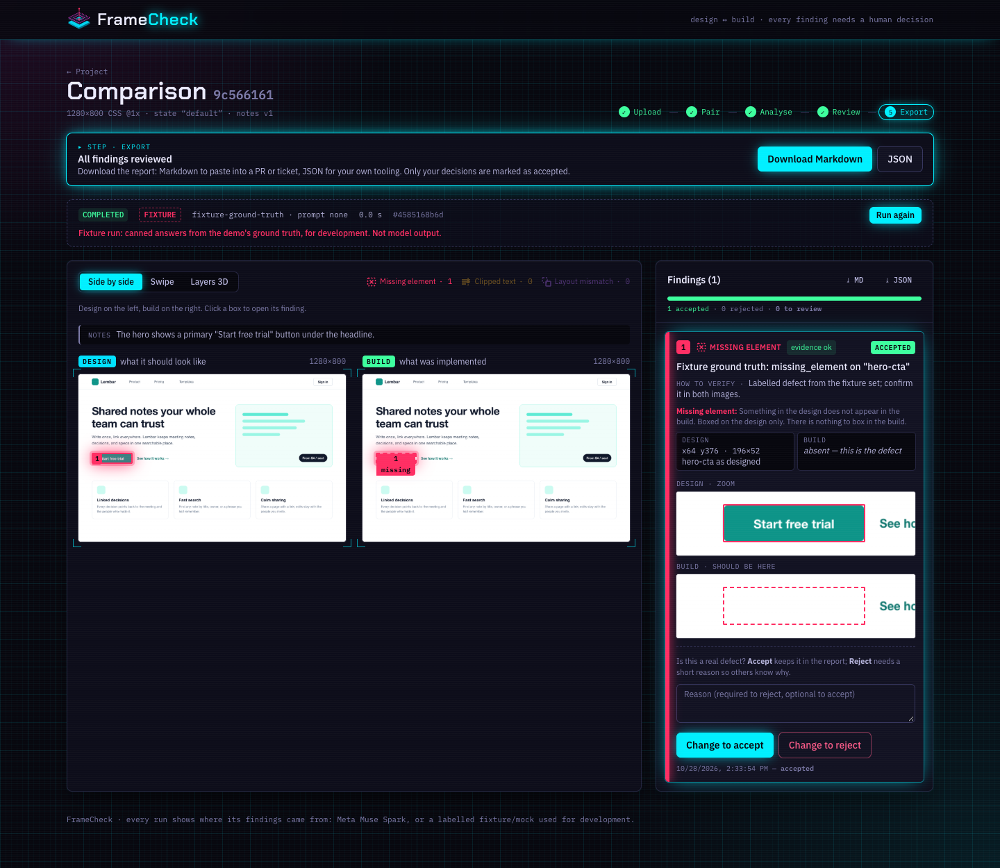
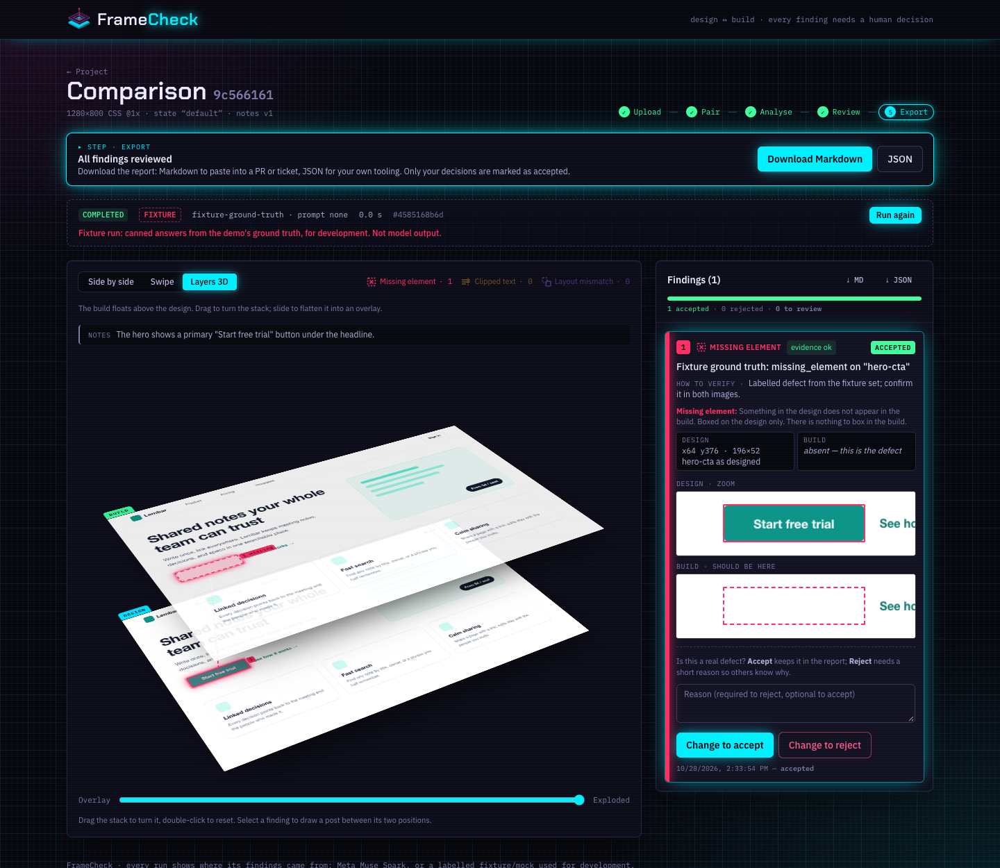
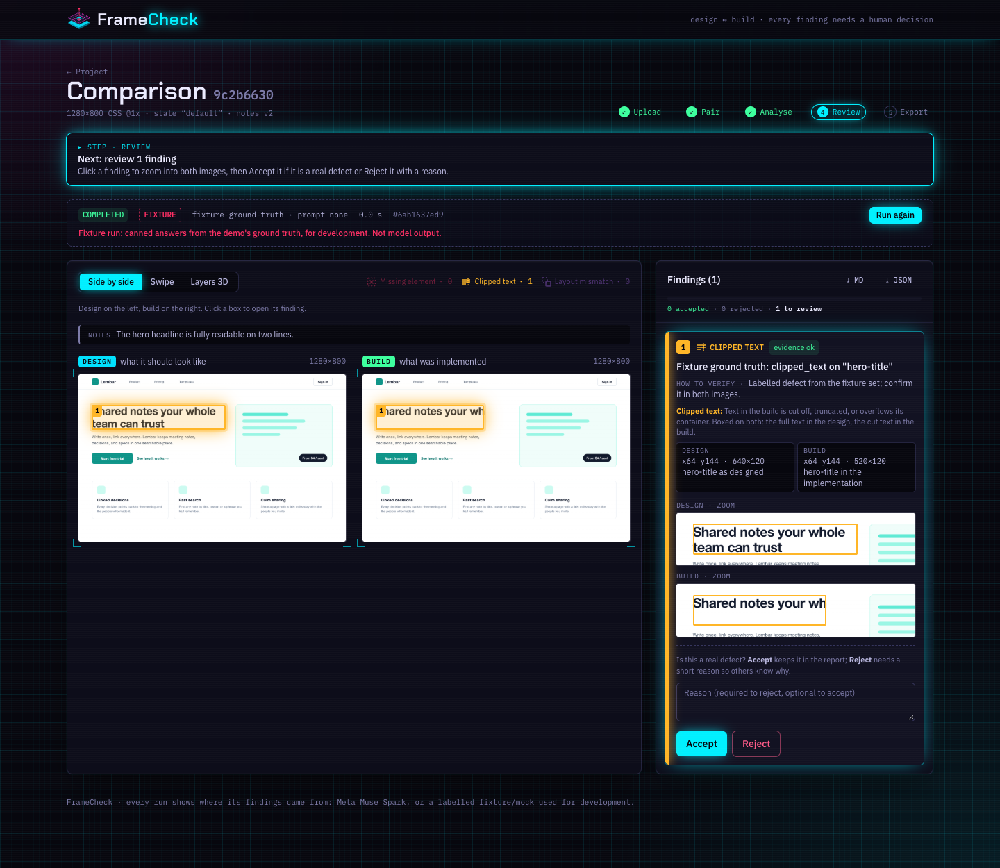
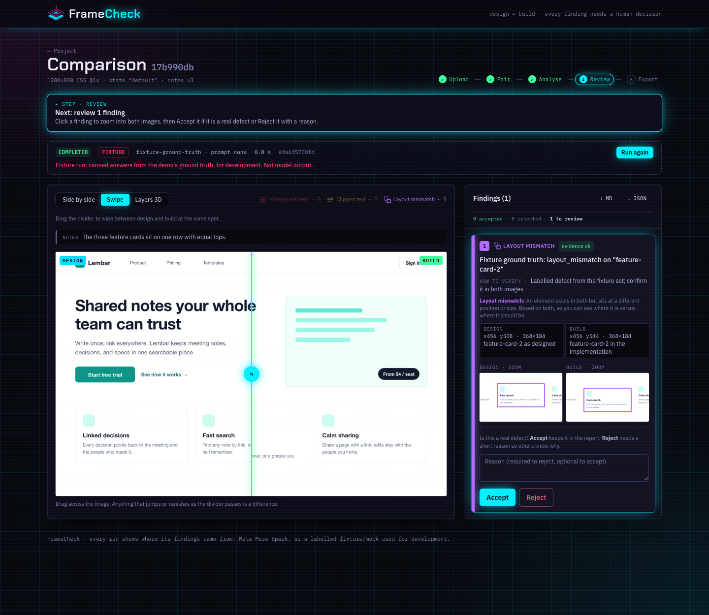

<p align="center">
  
</p>

<h1 align="center">FrameCheck</h1>

<p align="center"><b>Does the build match the design?</b><br>
Visual QA for front-end builds, powered by Meta Muse Spark. Every finding comes with evidence on both images, and a person decides what is real.</p>

<p align="center">Meta Global AI Developer Hackathon · Indie Developer track · Theme: Build for Your World</p>

<p align="center"><a href="https://youtu.be/gOiJNACygG0"></a><br>
<b>▶ <a href="https://youtu.be/gOiJNACygG0">Watch the demo video (2:32)</a></b> · live Muse Spark run, voice-over and captions</p>



## The problem

Front-end developers check their work against the design by flipping between a Figma export and a browser window. Small defects slip through: a button that never rendered, a headline cut off by `overflow: hidden`, a card that dropped 30 px. Pixel-diff tools flag every anti-aliasing change and cannot say *what* went wrong. Reviewers end up ignoring them.

FrameCheck asks a vision model the question a reviewer would ask, and then makes the answer checkable.

## What it does

1. **Upload** a design export and a screenshot of the build, captured at the same viewport, pixel ratio and page state. FrameCheck reads each image's size and suggests the pixel ratio.
2. **Pair** them and add a few notes on what matters ("the CTA is visible in the hero").
3. **Analyse.** Muse Spark compares the two images and returns findings in three categories:
   - **Missing element**: in the design, absent from the build. Boxed on the design, and drawn as a dashed "should be here" ghost on the build.
   - **Clipped text**: cut off, truncated or overflowing. Boxed on both.
   - **Layout mismatch**: the same element at a different position or size. Boxed on both.
4. **Review.** Click a finding to zoom both images to the same window. **Accept** it, or **Reject** it with a reason. Nothing counts until a person decides.
5. **Export** the reviewed run as Markdown for a PR or ticket, or as JSON.

Three ways to look at a pair: **Side by side**, **Swipe** (drag a divider across the two images), and **Layers 3D** (the build floats above the design; flatten it into a 50% overlay, or turn the stack and follow a post from a finding on the design up to the build).

| Layers 3D | Clipped text | Swipe |
| --- | --- | --- |
|  |  |  |

*These screenshots show `fixture` runs on the demo page, labelled as such in the UI. Muse Spark runs carry a "Muse Spark" badge.*

## How Muse Spark is used

FrameCheck sends one request per analysis to the Meta Model API (`POST /v1/responses`, model `muse-spark-1.3`) with both images and a prompt. Getting a vision model's output into a product that people can trust took most of the work:

- **Structured output only.** The response uses a strict `json_schema` (`findings[]` with category, summary, a check step and a box per image, plus `inspected_both_images`). Anything off-schema fails the run with `INVALID_OUTPUT`; there is no free-text parsing.
- **A coordinate contract.** The model answers on a 0–1000 grid of the image it saw. Large screenshots are downscaled (area-averaged) to a maximum side, and the exact crop and scale are stored with the run. Boxes map back to original pixels (floor for the minimum, ceil for the maximum), so overlays line up at any display size.
- **Provider output is untrusted.** Each finding is checked against its category's evidence rules (a missing element must not have a box on the build, clipped text and layout mismatches need both). Findings that break a rule are kept but marked "check evidence".
- **The developer's notes cannot steer the output.** Requirements go inside a delimited block, and the delimiter is escaped in user text.
- **Cost guard rails.** A per-process request cap (`MODEL_API_MAX_REQUESTS`), duplicate-input detection (the same images and settings are not re-analysed unless the user asks), and input/output token counts stored on every run.
- **Honest origins.** Every run records whether it came from `meta_api`, a `fixture`, or the offline `mock` baseline, and the UI shows it. Mock and fixture output is never presented as AI output.

### First real result

On a real application dashboard screenshot (not published) with three injected defects, one Muse Spark request (13 s, 5,225 input and 1,745 output tokens) returned all three with the right category and no false positives:

| Injected defect | Muse Spark finding | Box overlap with the injected region |
| --- | --- | --- |
| A button removed | Missing element: "The '…' button visible in the reference is missing in the actual implementation." | IoU 0.92 |
| A card title truncated | Clipped text: "…header text is truncated to '…' in the actual implementation." | full title on the design, remaining text on the build |
| A button group moved 160 px left | Layout mismatch: "…positioned further left in the actual implementation than in the reference." | IoU ≈ 0.96 on both images |

Personal data was covered with identical grey boxes in both images before sending, and the model ignored those boxes and the ticking clock. One pair is an anecdote, not an evaluation; see below.

## Evaluation

`demo/` contains a self-owned test page rendered by headless Chrome. Ground-truth boxes come from the DOM (`getBoundingClientRect`), and the capture tool checks that each render is deterministic and that the changed pixels stay inside the labelled component.

- **Dev set:** 1280×800, 12 defects (4 per category) and one unchanged control.
- **Holdout set:** a different page, wording, fonts and viewport (1440×900), 12 defects and two controls, one of them saved as JPEG q85 to add compression noise. Prompts are frozen before the holdout is scored.
- **Scorer:** `demo/tools/cmd/evaluate` matches a finding to a defect when the category agrees and box IoU ≥ 0.5, and counts any finding on a control as a false positive.

| Set | Origin | Recall | Precision | Control false positives |
| --- | --- | --- | --- | --- |
| dev | `fixture` (pipeline check) | 12/12 | 12/12 | 0 |
| dev | `mock` (pixel-diff baseline) | 2/12 | 2/13 | 0 |
| holdout | `fixture` | 12/12 | 12/12 | 0 |
| holdout | `mock` | 1/12 | 1/18 | 5 (all from JPEG noise) |
| dev / holdout | **Muse Spark** | *pending* | *pending* | *pending* |

Reports live in `demo/results/`. The mock row shows why a pixel diff is not enough: it finds *where* pixels changed, but labels everything a layout mismatch and is fooled by compression.

## Engineering

- **Backend:** Go 1.26, standard-library HTTP, Clean Architecture (domain → application → ports → adapters), PostgreSQL 16 with embedded migrations, content-addressed image storage. Upload validation sniffs the real image type, enforces 10 MB and 8000 px, and fully decodes every image.
- **Runs:** an input fingerprint (images, capture settings, notes, model, prompt and config versions), idempotency keys, at most one active run per project (a partial unique index), a sequential worker, and recovery of interrupted runs on restart.
- **Frontend:** React 19, TypeScript, Vite, Tailwind 4. Domain rules live in plain TypeScript with unit tests; the 3D views are CSS 3D transforms, with no WebGL or 3D library.
- **Tests:** `go test ./...` (domain, application with an in-memory repository, the Meta adapter against a local fake server, mock and fixture providers, scorer) and `pnpm test`. No test talks to the real API.

More detail: [architecture](docs/ARCHITECTURE.md), [contracts](docs/CONTRACTS.md), [evaluation plan](docs/EVALUATION.md), [progress log](docs/PROGRESS.md), [brand](docs/BRAND.md).

## Run it locally

Requires Docker, Go 1.26+, Node 20.19+ with pnpm, and Chrome (only for regenerating fixtures).

```sh
cp .env.example .env                                  # replace the DB password in both places
docker compose --project-name framecheck up -d postgres
cd framecheck_BE && go run ./cmd/api                  # http://127.0.0.1:8089
cd framecheck_FE && pnpm install && pnpm dev          # http://127.0.0.1:5181
```

Open http://127.0.0.1:5181 and press **Try it with a sample**. Without a Meta key the API uses the offline `mock` provider; `FRAMECHECK_PROVIDER=fixture` replays the demo ground truth. To use Muse Spark, set in `.env` (server side only):

```sh
FRAMECHECK_PROVIDER=meta
MODEL_API_ENABLED=true
MODEL_API_KEY=...
MODEL_API_MAX_REQUESTS=5
```

Details: [docs/DEVELOPMENT.md](docs/DEVELOPMENT.md).

## Limitations

- Three categories only. Colour, font rendering and wording are not checked on their own; an empty result is not a sign-off.
- Both images must be captured the same way. FrameCheck does not align or rescale mismatched screenshots.
- Content that changes between captures (clocks, captchas, live data) shows up as a difference unless the notes say to ignore it.
- One model call per analysis; accuracy on varied real-world pages is still being measured.

## Built during the hackathon

Planning documents were written on 22 October 2026; the code was written from 27 October, after the 26 October kickoff. The progress log records each step. The demo pages "Lembar" and "Kopiku" and all test images in this repository are original and self-made. The demo video's 3D animation, chapter cards, captions and all music and sound effects are generated from code in `submission/video/src/` (video files are not stored in the repository; see `submission/video/README.md` to rebuild them).

## Third-party software

| Component | Licence |
| --- | --- |
| [pgx](https://github.com/jackc/pgx), [chromedp](https://github.com/chromedp/chromedp), [cdproto](https://github.com/chromedp/cdproto) | MIT |
| [google/uuid](https://github.com/google/uuid) | BSD-3-Clause |
| React, Vite, Tailwind CSS, Vitest | MIT |
| TypeScript | Apache-2.0 |
| IBM Plex Sans/Mono, Chakra Petch, Instrument Serif (Google Fonts) | SIL Open Font License 1.1 |
| PostgreSQL (Docker image) | PostgreSQL License |

## Licence

FrameCheck is released under the [MIT License](LICENSE).
