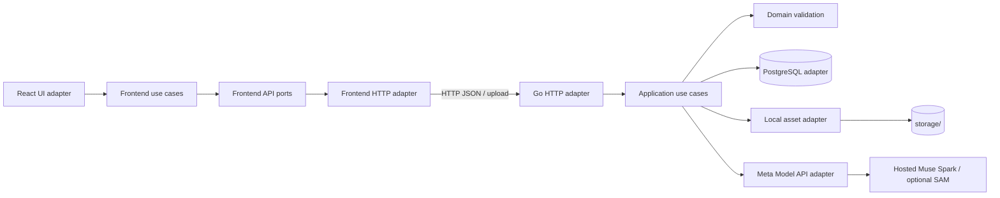

# Planned architecture

## Frontend package boundaries

- `framecheck_FE/src/domain`: project, comparison, run, finding, review types
  and pure rules. No React, fetch, or browser storage imports.
- `framecheck_FE/src/application`: upload, analyze, review, and export use cases;
  uses interfaces defined in `application/ports`.
- `framecheck_FE/src/adapters/api`: HTTP implementation of those ports and DTO
  mapping. This is the only layer that knows backend routes.
- `framecheck_FE/src/adapters/ui`: React pages, components, and view models.
  Tailwind styling stays here. UI invokes use cases; it does not embed network
  or domain validation logic.
- `framecheck_FE/src/app`: composition root, routing, and dependency wiring.

Frontend dependencies point inward: UI/API adapters depend on application
ports and domain; domain depends on no framework. Keep API DTOs distinct from
domain entities so a backend schema change does not spread through components.

## Backend package boundaries

- `framecheck_BE/internal/domain`: project, capture, comparison, run, finding,
  review, coordinate, and validation rules. No HTTP, SQL, or model SDK imports.
- `framecheck_BE/internal/application`: create project, ingest asset, create
  comparison, analyze, review, export. Depends on port interfaces.
- `framecheck_BE/internal/ports`: repository, asset store, inference provider,
  clock/ID interfaces.
- `framecheck_BE/internal/adapters/http`: request parsing and response mapping.
- `framecheck_BE/internal/adapters/postgres`: persistence and migrations.
- `framecheck_BE/internal/adapters/storage`: local files; object storage can be
  added later behind the port.
- `framecheck_BE/internal/adapters/meta`: hosted API integration and safe error
  mapping. Only the backend sees `MODEL_API_KEY`.

These are target paths, not implemented packages. The first slice should keep
one Go process and sequential inference jobs on an 8 GB M1 laptop.

## Data flow and evidence

1. Decode upload server-side; verify PNG/JPEG MIME from bytes, image dimensions,
   size limits, and SHA-256. Store bytes outside the database and metadata in it.
2. Pair captures only when viewport CSS dimensions, device pixel ratio, and
   content-state key agree. Record original raster dimensions too.
3. Freeze comparison input hashes and requirement version in a run. Compute an
   idempotency fingerprint from ordered asset hashes, requirement hash, model IDs,
   prompt/config version, and transform specification.
4. Send bounded images to Muse Spark via the backend. Ask for a strict finding
   schema and explicit evidence. Probe SAM separately for useful region masks;
   it must not be assumed to identify UI semantics.
5. Validate response shape, categories, image references, boxes, finite
   coordinates, bounds, and evidence sufficiency. Provider output is untrusted.
6. Convert analysis-image coordinates to original-image coordinates before
   storage. Draw overlays and crops from validated original-image boxes.
7. Persist run provenance, findings, and human reviews. Export the selected run
   with its provenance and uncertainty status.

## Coordinate contract

All public and persisted boxes use **original raster pixel coordinates**:
`{x, y, width, height}` with origin at top left and positive dimensions. The
image role is always explicit (`reference` or `actual`). A missing element may
have a reference box and no actual box; its expected actual location is a claim,
not fabricated evidence.

Muse Spark documentation describes normalized `0..1000` positions for the exact
image submitted. For analysis dimensions `Wa × Ha`, convert `x` to
`x * Wa / 1000` and `y` to `y * Ha / 1000`. If the analysis image is a crop of
the original beginning at `(cropX, cropY)` and scaled by `(scaleX, scaleY)`, map
back with `originalX = cropX + analysisX / scaleX` and similarly for Y. Apply
this to both box corners, then bound-check against original dimensions. Persist
the transform and rounding method (`floor` minimum, `ceil` maximum). Displayed
CSS size is not the original image size.

## Resource and privacy limits

Initial implementation limits: 10 MB per image, 8,000 pixels per side, two
images per comparison, one active analysis per project, timeout, no unbounded
retry. The first demo uses self-owned synthetic content. Logs must omit image
bytes, keys, and raw personal data. Local storage and PostgreSQL have
FrameCheck-specific names and are never shared with other projects.
